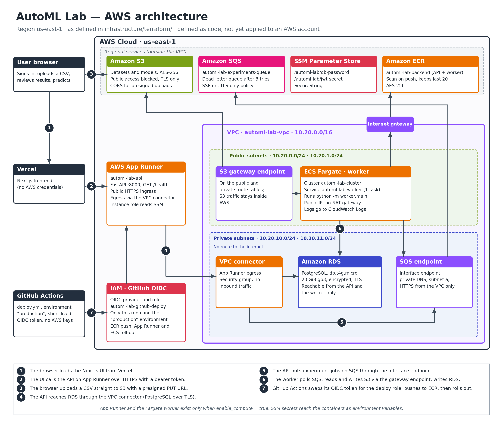

# AutoML Lab — Automated Model Training Pipeline

Automated model training, evaluation, model selection and inference for tabular CSV datasets.

Upload a CSV, choose a target column and task (classification or regression), and run a reproducible pipeline that validates the data, trains a set of candidate scikit-learn models, ranks them by your chosen metric, and stores the winning model as a versioned artifact with a prediction API.

**Planned stack:** Next.js, Python, FastAPI, scikit-learn, with optional Amazon S3, AWS Lambda, Amazon EventBridge, Amazon CloudWatch and IAM. The project is local-first: AWS is used only where account eligibility and limits allow, and zero cost is not guaranteed.

## Status
Milestones M1 to M5 are in place: upload a CSV, review its data-quality report, configure an experiment, watch a separate worker train the candidate models and rank them on a leaderboard, then approve the winning model and get predictions from it in the browser or over the API. Sign-in with per-user ownership, dataset deletion, model revocation and rate limiting (M7) are in place; Cloud mode (S3 with direct uploads and an SQS queue) and the AWS deployment (M8: a production Docker image, PostgreSQL on RDS, the API on App Runner, the worker on ECS Fargate, GitHub OIDC deployment and a cost alert, all defined in Terraform) are implemented as code but **have never been applied to or run on a real AWS account**; local mode is the default and needs no AWS account. The frontend is meant for Vercel. See the [roadmap](docs/ROADMAP.md), [deployment guide and cost notes](docs/DEPLOYMENT.md) and [infrastructure/terraform/README.md](infrastructure/terraform/README.md).

## Architecture



*Click the image for the full-size version. It shows the cloud mode defined in [infrastructure/terraform/](infrastructure/terraform/README.md) (region `us-east-1`), which has not been applied to an AWS account yet. Local mode needs none of it.*

- **Network:** one VPC (`10.20.0.0/16`) with two public and two private subnets across two availability zones, an internet gateway, **no NAT gateway**, an S3 gateway endpoint and an SQS interface endpoint.
- **API:** AWS App Runner runs the FastAPI service with public HTTPS ingress. Its outbound traffic goes through a VPC connector into the private subnets.
- **Worker:** an ECS Fargate service (one task) runs the training worker in the public subnets with a public IP, so it needs no NAT gateway. It polls SQS and never accepts inbound traffic.
- **Data:** RDS PostgreSQL (`db.t4g.micro`) sits in the private subnets and accepts connections only from the API and worker security groups. One private, encrypted S3 bucket holds uploaded datasets and trained models; browsers upload to it with presigned URLs.
- **Jobs and images:** an SQS queue with a dead-letter queue carries experiment jobs. One ECR repository (`automl-lab-backend`) holds the image that both the API and the worker run.
- **Secrets and CI/CD:** the database password and the token-signing key are SSM SecureString parameters. GitHub Actions deploys through an OIDC role, with no long-lived AWS keys.
- App Runner and the worker are created only when `enable_compute = true`. The deployment guide has the details and cost notes: [docs/DEPLOYMENT.md](docs/DEPLOYMENT.md).

The diagram is generated by [docs/architecture/generate_architecture.py](docs/architecture/generate_architecture.py) (`python docs/architecture/generate_architecture.py`, needs matplotlib). Edit the script when the Terraform changes.

## Quick start (local)
```bash
# Backend (Python 3.11+)
cd backend
pip install -e ".[dev]"
python -m app.cli create-user alice   # asks for a password (12+ characters); no public sign-up
uvicorn app.main:app --reload      # http://localhost:8000/health

# Worker (second terminal; runs queued experiments)
cd backend
python -m worker.main

# Frontend (Node 20.9+; developed with Node 24)
cd frontend
npm ci
npm run dev                        # http://localhost:3000
```
Copy `.env.example` to `.env` only if you need to override defaults; the variable names are listed there. Set `SECRET_KEY` (32+ random characters) to keep sign-ins across API restarts; it is required whenever `ENVIRONMENT` is not `local`. Then sign in at http://localhost:3000. `docker compose up` is also defined but has not been tested yet.

## Documentation
Start at the [documentation index](docs/README.md):
[PRD](docs/PRD.md) · [Architecture](docs/ARCHITECTURE.md) · [Design system](docs/DESIGN_SYSTEM.md) · [Roadmap](docs/ROADMAP.md) · [Security](docs/SECURITY.md)

Contributing: [CONTRIBUTING.md](CONTRIBUTING.md) · Agent guide: [AGENTS.md](AGENTS.md) · Maintainer: [@ChamathDilshanC](https://github.com/ChamathDilshanC)
