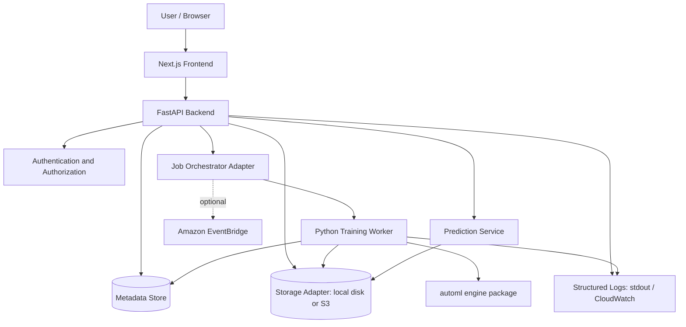
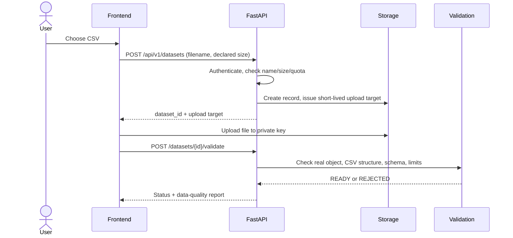
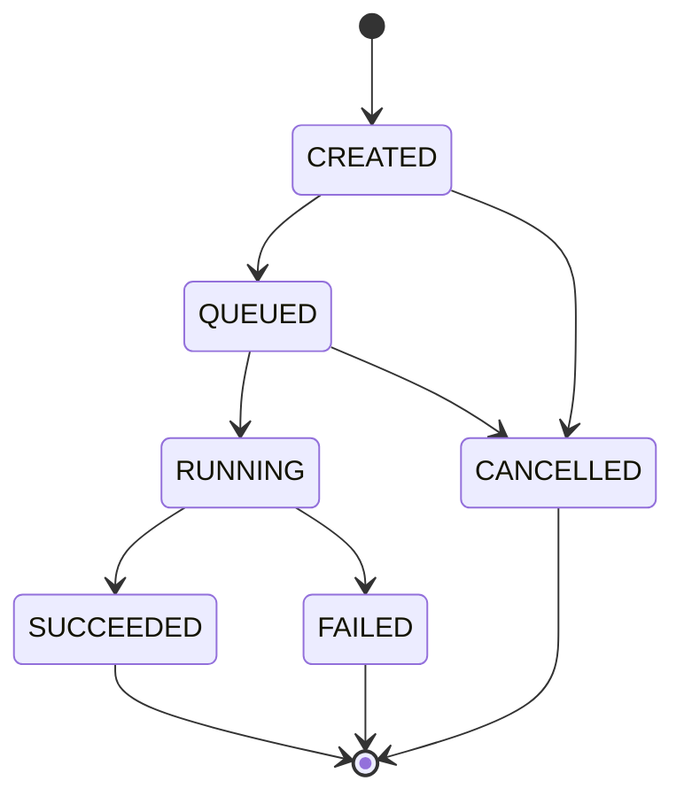

# System Architecture

> **Status of this document:** apart from the M1 scaffold, the repository contains no application code. Everything below is the **target architecture (Proposed)** taken from the owner's architecture brief. The *Current state* section is the only part that describes what exists today.

Legend: **Implemented** = verified in code/config · **Proposed** = planned design · **Assumption** · **Open question**. See [docs/README.md](README.md).

Related: [PRD](PRD.md) · [API spec](API_SPEC.md) · [Database schema](DATABASE_SCHEMA.md) · [Security](SECURITY.md) · [Deployment and cost](DEPLOYMENT.md) · [Testing](TESTING_STRATEGY.md) · [Roadmap](ROADMAP.md) · [ADRs](ADR/)

## 1. Current state

| Area | State |
|---|---|
| Frontend | **Implemented (M1):** Next.js App Router shell with a backend health indicator (`frontend/`) |
| Backend | **Implemented (M1):** FastAPI app, `GET /health`, request-ID middleware, CORS, settings, SQLite engine/session factory (`backend/app/`). No routes under `/api/v1` yet, no metadata tables |
| ML engine | **Implemented (M3):** `backend/automl/` provides dataset and target validation, a `ColumnTransformer` preprocessor, stratified/random splits, the algorithm allowlist with train-only grid search, held-out evaluation, and metric-aware ranking. It is not yet wired to the API or worker. `registry.py` is still a stub (M5) |
| Worker | **Stub (M1):** `backend/worker/main.py` logs and exits |
| Infrastructure | `infrastructure/terraform/` exists and is empty |
| CI | **Implemented (M1):** `.github/workflows/ci.yml` runs backend lint/format/type/test and frontend lint/type/build |
| Local run | `docker-compose.yml` defined; not yet run |

Engine functions (all in `backend/automl/`):

| Module | Public functions |
|---|---|
| `validation.py` | `validate_headers`, `validate_dataframe`, `validate_target`, `ValidationLimits`, `DataValidationError` |
| `preprocessing.py` | `split_column_types`, `build_preprocessor` (unfitted; fitted inside the training pipeline) |
| `splits.py` | `separate_target`, `split_data` returning a `DataSplit` that records strategy, test size and seed |
| `trainer.py` | `ESTIMATORS` allowlist, `available_algorithms`, `train_model` returning a `TrainedModel` (pipeline, best parameters, CV score, feature names, library versions) |
| `evaluator.py` | `METRICS` with direction, `evaluate`, `rank_results`, `scoring_for` |

Everything else in this document is the target design.

## 2. System context and boundaries (Proposed)

AutoML Lab lets a signed-in user upload a tabular CSV, choose a target column and ML task, run a reproducible training pipeline over an allowlisted set of scikit-learn estimators, compare results on a leaderboard, register the winning model as an immutable version, and request predictions through a versioned API.

**In scope for the first release:** small-to-medium tabular **classification and regression**; CSV only; CPU only.

**Out of scope:** distributed or GPU training, deep learning, user-supplied code execution, automatic public deployment of every model, support for formats other than CSV, guaranteed zero-cost AWS hosting.

External actors and systems:

| Actor / system | Interaction |
|---|---|
| User (browser) | Uses the Next.js UI; never holds AWS credentials |
| API client | Calls the prediction API with a bearer credential (mechanism TBD, see [SECURITY.md](SECURITY.md)) |
| Amazon S3 (cloud mode) | Private storage for datasets, artifacts, reports |
| Amazon EventBridge (optional) | Scheduled or event-driven automation such as cleanup |
| AWS Lambda (optional) | Short orchestration, validation, event handling only |
| Amazon CloudWatch (cloud mode) | Logs and metrics |

## 3. Architecture diagram (Proposed)



The diagram shows logical components. Placement of the FastAPI service and the worker in AWS is **Open** and must be decided after measuring memory, duration, package size and cost (see [DEPLOYMENT.md](DEPLOYMENT.md)).

## 4. Core architectural principle

**The ML engine is independent of AWS.** The `automl` package contains validation, preprocessing, splitting, training, evaluation and registry logic and imports no AWS SDK. Storage, job orchestration, and monitoring are reached through adapters: *local adapters* for development, *cloud adapters* for S3, queueing/orchestration and CloudWatch. This keeps the core testable, portable and cheap. See [ADR 0001](ADR/0001-local-first-adapter-architecture.md).

## 5. Repository and module map (Proposed target layout)

```text
automl-lab/
├── frontend/                 Next.js app: dashboard, datasets, experiments, models
│   ├── app/  components/  lib/
├── backend/
│   ├── app/                  FastAPI service
│   │   ├── api/              route handlers (versioned: /api/v1)
│   │   ├── core/             config, security, logging, request IDs
│   │   ├── db/               metadata persistence
│   │   ├── schemas/          request/response models
│   │   └── services/         dataset, experiment, model, prediction services
│   ├── automl/               AWS-independent ML engine
│   │   ├── validation.py  preprocessing.py  splits.py
│   │   └── trainer.py  evaluator.py  registry.py
│   ├── worker/main.py        job runner entry point
│   ├── tests/
│   └── pyproject.toml
├── infrastructure/terraform/ AWS resources (cloud mode only)
├── .github/workflows/        CI
├── docs/                     this documentation suite
├── docker-compose.yml        local run (Proposed)
└── .env.example              variable names only, no values
```

| Module | Owns | Must not |
|---|---|---|
| `frontend/` | UI, client state, calls to the API | Hold AWS credentials; read private S3 objects with permanent credentials |
| `backend/app/` | AuthN/Z, validation, metadata, presigned URLs, job creation, prediction serving | Leak stack traces, S3 keys or dataset contents in errors |
| `backend/automl/` | Pure ML pipeline logic | Import `boto3`, FastAPI, or any web/cloud SDK |
| `backend/worker/` | Claim a job, run the engine, persist results | Depend on an open HTTP request; execute user-supplied code |
| `infrastructure/` | IaC | Contain secrets or committed state files |

## 6. Components and responsibilities (Proposed)

### 6.1 Next.js frontend
Dataset upload with progress; dataset preview, schema and data-quality summary; task, target and metric selection; experiment configuration; job status and error display; leaderboard and metric visualisations; model registry and prediction testing. Direct-to-S3 uploads are allowed only through a short-lived presigned URL issued by the backend after authorisation and validation. Visual rules: [DESIGN_SYSTEM.md](DESIGN_SYSTEM.md).

### 6.2 FastAPI backend
Authentication and authorisation; request validation and API versioning; dataset/experiment/model metadata; upload-limit enforcement; presigned URLs; job creation and tracking; experiment results; prediction serving for approved models; audit events and structured logs. Routes: [API_SPEC.md](API_SPEC.md).

### 6.3 Metadata store
Metadata is kept separate from dataset and model files. Local: **SQLite**. Cloud: **Open** — a small DynamoDB table is one candidate, chosen only after checking current pricing, eligibility and operational needs. Entities and relationships: [DATABASE_SCHEMA.md](DATABASE_SCHEMA.md).

### 6.4 Object storage
Local mode uses a local artifact directory behind the storage adapter. Cloud mode uses private S3 with Block Public Access, encryption at rest, TLS, prefix-scoped permissions and lifecycle rules.

```text
datasets/{owner_id}/{dataset_id}/source.csv
experiments/{experiment_id}/reports/summary.json
models/{model_id}/{version}/model.joblib
models/{model_id}/{version}/metadata.json
```

Object names must not contain secrets or sensitive user data. Uploaded files are untrusted input.

### 6.5 Training worker
A separate Python process that does not depend on an open web request. Pipeline stages:

1. Load the approved dataset object.
2. Validate format, size, row/column counts and target selection.
3. Inspect schema; summarise missing values and categorical/numeric columns.
4. Split into train and test sets (stratified for suitable classification tasks; time-aware split offered for time-dependent data).
5. Fit preprocessing **only on training data**, inside a scikit-learn `Pipeline`/`ColumnTransformer`.
6. Train the allowlisted candidate estimators.
7. Evaluate on held-out data, or cross-validate within the training set for tuning.
8. Rank by the selected metric with configured tie-breakers.
9. Save the chosen fitted pipeline plus metrics and report.
10. Update experiment status and emit structured logs.

Algorithm allowlist (Proposed): classification — Logistic Regression, Decision Tree, Random Forest; regression — Linear Regression, Decision Tree Regressor, Random Forest Regressor. Code or class names are never imported from dataset content or user-provided configuration.

### 6.6 Job orchestration
| Mode | Mechanism | State |
|---|---|---|
| Local | Backend submits to a local worker queue | Proposed (first release) |
| Cloud | A durable queue pattern (SQS is a candidate) plus a worker runtime that is not Lambda for long jobs | **Open** |
| EventBridge | Optional: scheduled experiments, periodic cleanup, supported event routing. Not a job queue or training runtime | Proposed, optional |
| Lambda | Short orchestration, validation or event handling within its limits. Training does not default to Lambda | Proposed, optional |

### 6.7 Prediction service
Loads only registered, approved model artifacts produced by trusted pipeline code. An artifact contains the fitted preprocessing + estimator pipeline, feature names/schema, model version, training configuration and evaluation metrics. Safeguards: validate JSON against the model schema; documented policy for missing/extra/invalid fields; request-size and batch-size limits; model versions immutable; record which version served each prediction; authentication and rate limiting before any public exposure. `joblib`/pickle can execute code on load, so the system must never deserialise untrusted artifacts ([ADR 0002](ADR/0002-trusted-joblib-artifacts.md)).

## 7. End-to-end data flows (Proposed)

### 7.1 Dataset upload


### 7.2 Experiment execution


1. User picks task, target, primary metric and allowed algorithms.
2. Backend validates the configuration and creates the experiment (`QUEUED`).
3. A worker claims the job (`RUNNING`).
4. The worker runs validation, preprocessing, training and evaluation; each run's status, metrics and duration are recorded.
5. The best eligible model is selected by the declared metric and policy.
6. Artifact and report are saved; model metadata is registered.
7. Status becomes `SUCCEEDED` or `FAILED`.

Cancellation is implemented only if the worker can stop safely and keep metadata consistent (**Open**).

### 7.3 Prediction
Client calls the model-specific route → authenticate and authorise → validate request schema → load or reuse the approved pipeline → transform and predict → return predictions, model version and request ID. Logs record timing and outcome, never raw input values.

## 8. Machine-learning design

| Concern | Rule |
|---|---|
| Classification metrics | F1, precision, recall, ROC-AUC (only when the class structure/probabilities allow it), accuracy. Prefer a metric aligned with the objective over accuracy alone for imbalanced classes |
| Regression metrics | MAE, RMSE (lower is better), R² (higher is better); direction is explicit in metadata |
| Leakage | Target never used as a feature; imputers, encoders, scalers and feature selection fitted on training data only; test set never used for hyper-parameter selection |
| Reproducibility | Record split strategy, random seed, metric definition and library versions per experiment |
| Warnings | Identifier-like columns, high-cardinality columns, suspected target leakage, tiny datasets |
| Selection policy | Rank only runs that finished evaluation and pass minimum validity checks; store all metrics; state that the best candidate score is not a real-world performance guarantee |

## 9. Authentication and authorisation (Proposed)
A maintained authentication solution is used (provider **Open**). Every dataset, experiment and model access performs an ownership check. The prediction endpoint requires authentication and rate limiting before public exposure. Details: [SECURITY.md](SECURITY.md).

## 10. Configuration and secrets boundary
- Local development: environment variables loaded from an untracked `.env`; the repo carries only `.env.example` with variable **names**.
- AWS: IAM roles and temporary credentials; no access keys in code, frontend bundles or committed files.
- A managed secrets service is introduced only if required and budget-checked.
- Environment variable names are defined when the backend is scaffolded (**TBD**); none are claimed here.

## 11. Errors, retries and idempotency (Proposed)
- Bounded retries with back-off for transient storage/API errors.
- Deterministic validation failures are **not** retried; they surface as clear user-facing errors.
- Job submission is idempotent (a repeated submit does not create duplicate runs).
- A reaper marks abandoned `RUNNING` jobs as `FAILED` after a timeout (value **TBD**).
- API errors never expose stack traces, private keys, credentials or dataset content.

## 12. Observability (Proposed)
Structured logs with request IDs on stdout locally and in CloudWatch when deployed. Capture request latency and error rate, queue wait, training duration, failed-job counts, per-run metrics and configuration, worker exceptions and resource-limit failures, artifact transfer errors, model version and prediction latency. Review CloudWatch retention to control cost.

## 13. Test architecture
Unit, integration, ML, API, security, end-to-end and cost tests, with deterministic fixture datasets. See [TESTING_STRATEGY.md](TESTING_STRATEGY.md).

## 14. Deployment topology
| Option | Description | State |
|---|---|---|
| A — Local-first | Next.js, FastAPI, SQLite, local worker, local artifact directory, Docker Compose | Proposed, **recommended starting point** |
| B — Hybrid AWS | Separately hosted frontend, FastAPI on a chosen compute service, private S3, separate worker runtime, optional EventBridge, CloudWatch | Proposed; runtime **Open** |

Details and cost controls: [DEPLOYMENT.md](DEPLOYMENT.md).

## 15. Trade-offs and risks
| Risk / trade-off | Mitigation |
|---|---|
| AWS cost cannot be guaranteed at $0 | Local-first, strict limits, budgets/alerts (alerts are not a hard cap), teardown plan |
| Lambda limits vs training duration | Keep training in a separate worker runtime; Lambda only for short tasks |
| Pickle/joblib code execution on load | Trusted artifacts only, restricted write access, pinned dependencies |
| Malicious or malformed CSVs | Allowlisted type, real-size limits, safe parsing, timeouts, row/column caps |
| Overfitting to the leaderboard | Held-out test set, clear caveat in the UI |
| Premature cloud lock-in | Adapter boundary around storage, jobs, monitoring |

## 16. Architecture decision records
- [ADR 0001 — Local-first, adapter-based architecture](ADR/0001-local-first-adapter-architecture.md)
- [ADR 0002 — Trusted joblib artifacts only](ADR/0002-trusted-joblib-artifacts.md)

## 17. Open questions
1. Authentication provider and API-credential model for the prediction endpoint.
2. Cloud metadata store (e.g. DynamoDB) and cloud worker runtime.
3. Concrete limits: maximum file size, rows, columns, training time, batch size.
4. Whether experiment cancellation is in the first release.
5. Whether time-aware splits are in the first release.
