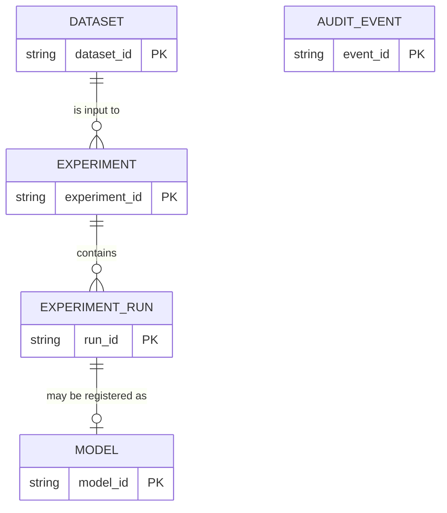

# Database Schema

> **Status:** **Proposed.** No database or migration exists. The entities and core fields come from the architecture brief; column types, indexes and constraints below are design proposals. When migrations are added, they become the source of truth.

Related: [Architecture § 6.3](ARCHITECTURE.md#63-metadata-store) · [PRD](PRD.md) · [Security](SECURITY.md)

## 1. Storage choice
| Environment | Store | State |
|---|---|---|
| Local development | SQLite | Proposed |
| AWS | Managed store — small DynamoDB table is one candidate | **Open**; decide after checking pricing, eligibility and operational needs |

Metadata is stored separately from dataset and model files, which live in object storage ([ARCHITECTURE § 6.4](ARCHITECTURE.md#64-object-storage)).

## 2. Entity relationships

`AUDIT_EVENT` references resources by ID only and is intentionally not a foreign-key child.

## 3. Entities

### 3.1 Dataset
| Field | Notes |
|---|---|
| `dataset_id` | PK |
| `owner_id` | Ownership check on every access |
| `storage_key` | Object key, e.g. `datasets/{owner_id}/{dataset_id}/source.csv`; never returned to clients |
| `original_filename` | Display only; sanitised |
| `size_bytes` | Measured, not just declared |
| `row_count`, `column_count` | Set on validation |
| `schema_summary` | JSON: column names, inferred types, missing counts |
| `validation_status` | `PENDING_UPLOAD`, `READY`, `REJECTED` (names Proposed) |
| `validation_message` | Safe, non-leaky reason |
| `created_at` | Timestamp |

### 3.2 Experiment
| Field | Notes |
|---|---|
| `experiment_id` | PK |
| `owner_id`, `dataset_id` | FK to dataset |
| `target_column`, `task_type`, `metric` | `task_type`: classification or regression |
| `random_seed` | Reproducibility |
| `configuration` | JSON: algorithms, split strategy, test size, tie-breakers |
| `library_versions` | JSON recorded at run time |
| `status` | `CREATED, QUEUED, RUNNING, SUCCEEDED, FAILED, CANCELLED` |
| `created_at`, `started_at`, `finished_at` | Timestamps |
| `error_summary` | Safe user-facing summary |
| `idempotency_key` | Prevents duplicate submissions (Proposed) |

### 3.3 ExperimentRun
| Field | Notes |
|---|---|
| `run_id` | PK |
| `experiment_id` | FK |
| `algorithm` | Allowlisted identifier |
| `hyperparameters` | JSON |
| `metrics` | JSON: all computed metrics |
| `duration_seconds` | |
| `status` | Run-level status |
| `artifact_key` | Pointer to run artifact, if kept |

### 3.4 Model
| Field | Notes |
|---|---|
| `model_id` | Logical model ID |
| `version` | Immutable version label; unique with `model_id` |
| `experiment_id` / `run_id` | Provenance |
| `artifact_key` | e.g. `models/{model_id}/{version}/model.joblib` |
| `preprocessing_spec`, `feature_schema` | JSON |
| `selected_metric`, `metrics` | |
| `approval_status` | e.g. `PENDING`, `APPROVED`, `REVOKED` (names Proposed) |
| `created_at` | |

### 3.5 AuditEvent
`event_id`, `actor`, `action`, `resource_id`, `timestamp`, `outcome`. **Never** stores dataset row values, secrets or tokens.

## 4. Indexing and constraints (Proposed)
- Index `owner_id` on Dataset, Experiment and Model for listing.
- Unique `(model_id, version)`.
- Index `(status)` on Experiment for the worker's claim query and the stale-job reaper.
- Unique `idempotency_key` per owner.
- Foreign keys enforced in SQLite (`PRAGMA foreign_keys=ON`).

## 5. Migrations
Tool **TBD** (e.g. Alembic for SQLAlchemy). Migrations are forward-only, reviewed in PRs, and tested against a clean database in CI.

## 6. Retention
Deleting a dataset removes its source object and derived artifacts, subject to documented retention rules (**TBD**); audit events keep IDs only. Temporary uploads that never reach `READY` are expired by lifecycle rules.

## 7. Open questions
Cloud store selection; ORM choice; whether model versions are integers or semantic labels; retention windows.
