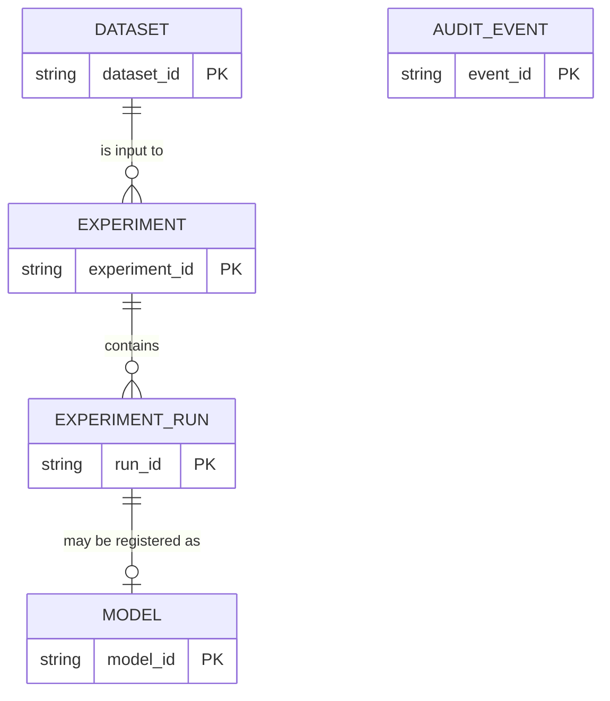

# Database Schema

> **Status:** **Proposed**, except the `datasets` (M2), `experiments` and `experiment_runs` (M4), `models` (M5), and `users` and `audit_events` (M7) tables, which are implemented (`backend/app/db/models.py`). There is no migration tool yet: tables are created on application start-up with `create_all` as an interim step. The entities and core fields come from the architecture brief; column types, indexes and constraints below are design proposals. When migrations are added, they become the source of truth.

Related: [Architecture § 6.3](ARCHITECTURE.md#63-metadata-store) · [PRD](PRD.md) · [Security](SECURITY.md)

## 1. Storage choice
| Environment | Store | State |
|---|---|---|
| Local development | SQLite | Proposed |
| AWS | Managed store — small DynamoDB table is one candidate | **Open**; decide after checking pricing, eligibility and operational needs |

Metadata is stored separately from dataset and model files, which live in object storage ([ARCHITECTURE § 6.4](ARCHITECTURE.md#64-object-storage)).

## 2. Entity relationships

`AUDIT_EVENT` references resources by ID only and is intentionally not a foreign-key child.

## 3. Entities

### 3.1 Dataset
| Field | Notes |
|---|---|
| `dataset_id` | PK |
| `owner_id` | Ownership check on every access |
| `storage_key` | Object key, e.g. `datasets/{owner_id}/{dataset_id}/source.csv`; never returned to clients |
| `original_filename` | Display only; sanitised |
| `size_bytes` | Measured, not just declared |
| `row_count`, `column_count` | Set on validation |
| `schema_summary` | JSON: column names, inferred types, missing counts |
| `validation_status` | `PENDING_UPLOAD`, `READY`, `REJECTED` (names Proposed) |
| `validation_message` | Safe, non-leaky reason |
| `created_at` | Timestamp |

**Implemented columns (M2):** `dataset_id` (PK, `ds_` + random hex), `owner_id` (indexed; a fixed placeholder `local-user` until authentication in M7), `storage_key`, `original_filename` (sanitised), `size_bytes`, `status` (`UPLOADED`, `READY`, `REJECTED`; `PENDING_UPLOAD` is reserved for the presigned-upload flow), `row_count`, `column_count`, `schema_summary` (JSON list of column summaries), `quality_warnings` (JSON list), `validation_message`, `created_at` (naive UTC). `validation_status` above corresponds to `status`.

### 3.2 Experiment
| Field | Notes |
|---|---|
| `experiment_id` | PK |
| `owner_id`, `dataset_id` | FK to dataset |
| `target_column`, `task_type`, `metric` | `task_type`: classification or regression |
| `random_seed` | Reproducibility |
| `configuration` | JSON: algorithms, split strategy, test size, tie-breakers |
| `library_versions` | JSON recorded at run time |
| `status` | `CREATED, QUEUED, RUNNING, SUCCEEDED, FAILED, CANCELLED` |
| `created_at`, `started_at`, `finished_at` | Timestamps |
| `error_summary` | Safe user-facing summary |
| `idempotency_key` | Prevents duplicate submissions (Proposed) |

### 3.3 ExperimentRun
| Field | Notes |
|---|---|
| `run_id` | PK |
| `experiment_id` | FK |
| `algorithm` | Allowlisted identifier |
| `hyperparameters` | JSON |
| `metrics` | JSON: all computed metrics |
| `duration_seconds` | |
| `status` | Run-level status |
| `artifact_key` | Pointer to run artifact, if kept |

**Implemented columns (M4).** `experiments`: `experiment_id` (PK, `ex_` + hex), `owner_id`, `dataset_id` (FK), `target_column`, `task`, `metric`, `algorithms` (JSON list), `random_seed`, `test_size`, `status`, `idempotency_key` (unique per owner when set), `created_at`, `started_at`, `finished_at`, `error_summary`, `selected_run_id`, `split_info` (JSON), `library_versions` (JSON). Index on `(status, created_at)` serves the worker's claim query. `experiment_runs`: `run_id` (PK, `rn_` + hex), `experiment_id` (FK), `algorithm` (unique per experiment), `status` (`SUCCEEDED` or `FAILED`), `hyperparameters` (JSON), `cv_score`, `cv_folds`, `metrics` (JSON, `null` for metrics that could not be computed), `duration_seconds`, `error_summary`, `rank` (`null` when unranked), `created_at`. No `configuration` JSON column: the configuration is stored as separate columns. The API and the worker are separate processes sharing one SQLite file, so connections use WAL mode and a 5-second busy timeout.

### 3.4 Model
| Field | Notes |
|---|---|
| `model_id` | Logical model ID |
| `version` | Immutable version label; unique with `model_id` |
| `experiment_id` / `run_id` | Provenance |
| `artifact_key` | e.g. `models/{model_id}/{version}/model.joblib` |
| `preprocessing_spec`, `feature_schema` | JSON |
| `selected_metric`, `metrics` | |
| `approval_status` | e.g. `PENDING`, `APPROVED`, `REVOKED` (names Proposed) |
| `created_at` | |

**Implemented columns (M5).** `models`: `model_id` (PK, `md_` + hex; identifies one immutable artifact, unlike the sketch above where it was the logical model), `version` (integer, counted per owner, dataset, target column and task; unique together with them), `owner_id`, `dataset_id`, `experiment_id`, `run_id`, `task`, `target_column`, `algorithm`, `metric`, `metrics` (winner's test scores), `hyperparameters`, `feature_schema` (JSON), `classes` (JSON, classification only), `library_versions`, `artifact_key`, `metadata_key`, `artifact_sha256`, `artifact_bytes`, `approval_status` (`PENDING`, `APPROVED`, `REVOKED`), `approved_at`, `created_at`. There is no update path for the artifact fields. `REVOKED` was added in M7; a deployment status is not implemented.

**Implemented (M7).** `users`: `user_id` (PK, `us_` + hex), `username` (unique, stored lower-case), `password_hash` (scrypt, parameters and salt inside the string), `is_active`, `created_at`. `owner_id` columns on datasets, experiments and models now hold a `user_id`. Rows created before M7 carry the placeholder owner `local-user`; `python -m app.cli claim-legacy <username>` reassigns them. No existing table gained a column in M7, because there is still no migration tool: new tables are created at start-up and existing ones are never altered.

**`audit_events`** (M7): `event_id` (PK, `ev_` + hex), `created_at`, `actor_id` (null when nobody is signed in), `action`, `resource_type`, `resource_id`, `outcome` (`success` or `failure`), `detail` (short, never a password, token or data value). Written for sign-in successes and failures (a failure records the attempted username), account creation, model approval and revocation, and dataset deletion. Nothing reads the table through the API yet and there is no retention policy.

### 3.5 AuditEvent
`event_id`, `actor`, `action`, `resource_id`, `timestamp`, `outcome`. **Never** stores dataset row values, secrets or tokens.

## 4. Indexing and constraints (Proposed)
- Index `owner_id` on Dataset, Experiment and Model for listing.
- Unique `(model_id, version)`.
- Index `(status)` on Experiment for the worker's claim query and the stale-job reaper.
- Unique `idempotency_key` per owner.
- Foreign keys enforced in SQLite (`PRAGMA foreign_keys=ON`).

## 5. Migrations
Tool **TBD** (e.g. Alembic for SQLAlchemy). Migrations are forward-only, reviewed in PRs, and tested against a clean database in CI.

## 6. Retention
Deleting a dataset removes its source object and derived artifacts, subject to documented retention rules (**TBD**); audit events keep IDs only. Temporary uploads that never reach `READY` are expired by lifecycle rules.

## 7. Open questions
Cloud store selection; ORM choice; whether model versions are integers or semantic labels; retention windows.
