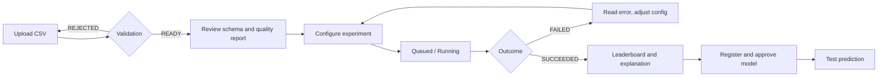

# Design System

> **Status:** only the dataset and experiment pages exist (M2, M4); everything else here is **Proposed**. Tokens listed are starting values to be implemented as CSS variables / theme tokens in the Next.js app; none of them exist in code today. Contrast ratios were computed with the WCAG 2.x relative-luminance formula during authoring.

**Implemented (M2, M4):** the colour tokens below are CSS variables in `frontend/app/globals.css` with a `prefers-color-scheme` dark theme (no manual override yet), plus `StatusBadge` (dataset and experiment statuses), `DatasetUploader`, `DataQualityReport`, `ExperimentForm`, `ExperimentDetail` (polls every 2 seconds until the experiment finishes, announced through a polite live region) and `Leaderboard` (rank, best-run badge with text and icon, primary metric emphasised with a direction arrow, all metrics, failed runs listed separately), and the routes `/datasets/new`, `/datasets/[id]`, `/experiments/new` and `/experiments/[id]`. Verified in a headless browser in light and dark; no automated UI tests yet.

Related: [PRD](PRD.md) · [Architecture § 6.1](ARCHITECTURE.md#61-nextjs-frontend)

## 1. Product design principles
1. **Honest results.** Never imply a leaderboard score guarantees real-world performance (FR-032).
2. **Explain, don't just show.** Every ranking, warning and rejection says *why*.
3. **Status is always visible.** A user can tell what state a dataset, experiment or model is in without opening it.
4. **Safe by default.** Destructive actions confirm; no secrets or raw dataset values in UI errors.
5. **Data-dense but calm.** Tables and charts are the content; chrome stays quiet.
6. **Accessible without extras.** Colour is never the only carrier of meaning.

## 2. Visual direction
Neutral, technical, light and dark themes, one accent colour, tabular numerals for metrics. No illustrative branding has been decided (logo and wordmark **TBD**).

## 3. Theme strategy
- Light and dark themes via semantic tokens; components consume tokens, never raw hex.
- Default follows the OS (`prefers-color-scheme`) with a manual override stored per user in the browser.

## 4. Semantic colour tokens (Proposed)
| Token | Light | Dark | Use |
|---|---|---|---|
| `--bg` | `#FFFFFF` | `#0B1020` | Page background |
| `--surface` | `#F3F4F6` | `#161C2E` | Cards, panels, table headers |
| `--text` | `#111827` | `#E5E7EB` | Body text |
| `--text-muted` | `#4B5563` | `#9CA3AF` | Secondary text |
| `--border` | `#D1D5DB` | `#2B3350` | Dividers and card outlines (added in M2; not a text colour) |
| `--accent` | `#2563EB` | `#60A5FA` | Primary actions, links, focus ring |
| `--on-accent` | `#FFFFFF` | `#0B1020` | Text on accent fills |
| `--success` | `#15803D` | `#4ADE80` | `SUCCEEDED`, `READY` |
| `--warning` | `#B45309` | `#FBBF24` | Data-quality warnings |
| `--danger` | `#B91C1C` | `#F87171` | `FAILED`, `REJECTED`, destructive actions |
| `--info` | `--accent` | `--accent` | `RUNNING`, `QUEUED` accents |

Measured contrast against the page background (text-size minimum 4.5:1):

| Pair | Light | Dark |
|---|---|---|
| `--text` / `--bg` | 17.74 | 15.29 |
| `--text-muted` / `--bg` | 7.56 | 7.46 |
| `--accent` / `--bg` | 5.17 | 7.45 |
| `--on-accent` / `--accent` | 5.17 | 7.45 |
| `--danger` / `--bg` | 6.47 | 6.84 |
| `--success` / `--bg` | 5.02 | 10.86 |
| `--warning` / `--bg` | 5.02 | 11.34 |
| `--text-muted` / `--surface` | 6.87 | 6.67 |

Chart series colours (categorical, colour-blind-safe palette) are **TBD**; charts must also differ by marker/line style and carry direct labels or legends.

## 5. Typography (Proposed)
| Token | Size / line height | Use |
|---|---|---|
| `text-xs` | 12 / 16 | Captions, table meta |
| `text-sm` | 14 / 20 | Table cells, helper text |
| `text-base` | 16 / 24 | Body |
| `text-lg` | 18 / 28 | Card titles |
| `text-xl` | 24 / 32 | Page section titles |
| `text-2xl` | 32 / 40 | Page titles |

Font family **TBD** (system UI stack acceptable for the MVP). Metrics use tabular numerals. Body text is at least 16 px.

## 6. Spacing, radius, elevation, layout
- **Spacing scale:** 4 px base unit — 4, 8, 12, 16, 24, 32, 48.
- **Radius:** 4 (inputs), 8 (cards), 999 (badges).
- **Elevation:** at most two levels (flat card with 1 px border; popover/dialog shadow).
- **Layout:** 12-column grid at ≥ 1024 px, single column below; content max width ≈ 1200 px; page gutter 16 px on phones.
- **Breakpoints:** 480 (small phone), 768 (tablet), 1024 (desktop), 1440 (wide).

## 7. Navigation pattern
Persistent primary navigation with four destinations matching the app routes: **Dashboard**, **Datasets**, **Experiments**, **Models**. Left sidebar ≥ 1024 px, collapsing to a top bar with a menu below. Breadcrumbs on detail pages (Datasets › *name*). Current page marked with `aria-current="page"` and a non-colour indicator.

## 8. Screen inventory (Proposed)
| Screen | Route (Proposed) | Purpose | PRD |
|---|---|---|---|
| Sign in | TBD (provider-dependent) | Authenticate | FR-060 |
| Dashboard | `/dashboard` | Recent datasets, running experiments, latest models | FR-014 |
| Datasets list | `/datasets` | Upload entry point, list with status | FR-001 |
| Dataset detail | `/datasets/[id]` | Preview, schema, quality report, warnings, delete | FR-003–FR-006 |
| New experiment | `/experiments/new` | Target, task, metric, algorithms, seed | FR-010, FR-011 |
| Experiment detail | `/experiments/[id]` | Status, run table, errors, leaderboard, explanation | FR-012–FR-033 |
| Models list | `/models` | Registered models and versions | FR-043 |
| Model detail | `/models/[id]` | Metadata, metrics, schema, prediction tester | FR-040–FR-054 |

## 9. Core user flows

## 10. Component inventory
| Component | Notes |
|---|---|
| `AppShell`, `NavItem`, `Breadcrumbs` | Navigation layout |
| `Button` (primary/secondary/ghost/destructive) | Loading state keeps width; disabled has reason via text where possible |
| `TextInput`, `Select`, `NumberInput`, `Checkbox`, `RadioGroup` | Visible label always; helper and error text linked with `aria-describedby` |
| `DatasetUploader` | Drag-and-drop **and** keyboard-activated file button; shows progress, size and type limits |
| `SchemaTable` | Column name, inferred type, missing %, unique count; sortable |
| `DataQualityReport` | Grouped warnings with severity icon + text |
| `ExperimentForm` | Task → metric options filtered by task; algorithm checklist limited to the allowlist |
| `StatusBadge` | Text + icon + colour for `CREATED, QUEUED, RUNNING, SUCCEEDED, FAILED, CANCELLED, READY, REJECTED` |
| `Leaderboard` | Ranked table; primary metric column emphasised; direction indicator (↑ higher / ↓ lower is better) |
| `MetricChart` | Bar/line comparison with accessible table alternative |
| `ModelCard` | Version, metrics, approval status, schema link |
| `PredictionForm` | Generated from model schema; shows validation errors per field |
| `Toast`, `InlineAlert`, `ConfirmDialog` | Feedback and destructive confirmation |
| `EmptyState`, `Skeleton`, `ErrorState` | Placeholders for every list and detail view |

### Required states
Every interactive component defines: default, hover, focus-visible, active, disabled, loading, error, and (for collections) empty. Focus ring: 2 px `--accent` outline with 2 px offset, never removed.

## 11. Forms and validation
- Validate on blur and on submit; never block typing.
- Errors state what is wrong and how to fix it ("Target column `price` is not in this dataset") and never include raw dataset values.
- Server errors map to field errors when a field is identified, otherwise to an `InlineAlert` with the request ID.
- Long operations (upload, validation) show progress and remain cancellable where the API allows.

## 12. Notifications and feedback
- `Toast` for transient confirmations (auto-dismiss ≥ 5 s, pausable, `role="status"`).
- Persistent `InlineAlert` for failures and data-quality warnings (`role="alert"` for blocking errors).
- Experiment status updates are polled or pushed (**Open**) and announced via an `aria-live="polite"` region.

## 13. Motion
Short (≤ 200 ms) transitions on state changes only. Honour `prefers-reduced-motion` by removing non-essential animation and replacing spinners with static text where practical.

## 14. Accessibility checklist (target WCAG 2.2 AA)
- Full keyboard operability; logical focus order; skip-to-content link.
- Touch targets at least 24×24 CSS px (aim for 44×44 on primary actions).
- Status and metric direction conveyed by text/icon, not colour alone.
- Charts have a data-table alternative.
- Form controls have programmatic labels.
- Test with a screen reader and keyboard-only pass before the MVP release.

## 15. Data tables and pagination
Server-side pagination for datasets, experiments and models (shape: see [API_SPEC.md](API_SPEC.md)). Sticky header, sortable columns where meaningful, row-level actions in a menu with an accessible name. Numeric columns right-aligned with tabular numerals.

## 16. Component structure and consistency checks (Proposed)
- Components live under `frontend/components/`, pages under `frontend/app/`, shared API client and helpers under `frontend/lib/`.
- No hard-coded colours, spacing or font sizes in components; use tokens.
- Each component documents props and states; visual regression or story-based checks are **TBD**.
- Lint rule or review checklist: new UI must use existing components before adding new ones.

## 17. Open decisions
Logo/brand, font, chart palette, charting library, component library (build vs adopt), status update mechanism (polling vs push).
