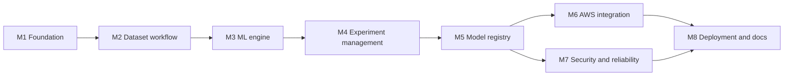

# Roadmap

> **Status:** M1 is **implemented and merged** (CI passing). M2, M3 and M4 are **implemented** (see their rows). All other milestones are **Proposed** and **Not started**. Milestones follow the order in the owner's architecture brief. Dates are intentionally absent (none supplied).

Related: [PRD](PRD.md) · [Architecture](ARCHITECTURE.md) · [Testing](TESTING_STRATEGY.md)

## Milestone overview

M3 can start in parallel with M2 because the engine is AWS- and web-independent.

## Milestones
| ID | Milestone | Deliverables | Depends on | PRD coverage | Exit criteria | Status |
|---|---|---|---|---|---|---|
| M1 | Foundation | Repo structure, Next.js app shell, FastAPI skeleton with `/health`, local SQLite, CI (lint, test, build), `.env.example`, Docker Compose | — | FR-062, NFR-010 | CI green from a clean checkout | Implemented; CI passing; Docker Compose run not verified |
| M2 | Dataset workflow | CSV upload, storage adapter (local), validation, schema preview, quality report, limits | M1 | FR-001–FR-005 | Valid fixture becomes `READY`; malformed fixtures `REJECTED` with safe errors | Implemented with local storage; owner is a placeholder until M7; presigned upload deferred to M6 |
| M3 | ML engine | `automl` package: validation, preprocessing pipeline, splits, trainer, evaluator, metrics | M1 (not M2) | FR-020–FR-027, FR-030 | Deterministic ML tests pass; no leakage tests pass | Implemented (engine only; not yet exposed through the API) |
| M4 | Experiment management | Experiment API, job states, local worker, run history, leaderboard, reports | M2, M3 | FR-010–FR-014, FR-031–FR-033 | Fixture experiment runs queued → succeeded; leaderboard explains winner | Implemented with a local polling worker. Cancellation and stored run reports are not included |
| M5 | Model registry | Artifact versioning, metadata, approval, prediction endpoint, prediction test UI | M4 | FR-040–FR-054 | Registered model serves valid prediction; invalid payloads rejected | Not started |
| M6 | AWS integration | S3 adapter, scoped IAM, optional EventBridge orchestration, CloudWatch logging | M5 | NFR-006, NFR-009 | Same E2E test passes against S3 adapter with no long-lived stray resources | Not started |
| M7 | Security and reliability | Auth, ownership checks everywhere, retention/deletion, retries, rate limits, failure handling | M5 | FR-006, FR-013, FR-060, FR-061, NFR-001–NFR-004 | Security test suite passes; abandoned jobs are reaped | Not started |
| M8 | Deployment and documentation | Terraform, CI/CD with OIDC, architecture diagram, screenshots, setup and cost notes | M6, M7 | § 6 MVP | Definition of Done in the PRD demonstrably met | Not started |

## Recommended first milestone
**M1 Foundation**, followed immediately by **M3 ML engine**. The engine is the product's core value, is cheap to test, and has no external dependencies, which de-risks the project before any cloud work.

## Deferred / Open
Cancellation (FR-015), time-aware splits (FR-016), multi-user sharing, additional file formats, additional algorithms.
